# ferro-esercizi

Schede di esecuzione degli esercizi in palestra, **in italiano**, scritte come le spiegherebbe un coach:
come regolare la macchina, come si esegue, gli errori comuni con la correzione, dove si deve sentire
e quando fermarsi. Le usa l'app [Ferro](https://github.com/JackMagna/ferro); chiunque può riusarle.

Oggi: **45 schede**, collegate a **56 esercizi** di [free-exercise-db](https://github.com/yuhonas/free-exercise-db)
(macchine, cavi, pesi liberi, corpo libero).

## Animazioni

Mini video 3D e disegni della posizione di partenza per tutti i **45 esercizi**, fatti in codice con three.js:
manichino neutro, macchine generiche, il muscolo che lavora in giallo. La pagina con video, disegni e testi è
[esempi/index.html](esempi/index.html).

### Macchine

| Abductor | Adductor | Chest press | Crunch alla macchina |
|:-:|:-:|:-:|:-:|
| [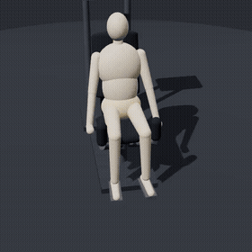](dist/animations/abductor.mp4) | [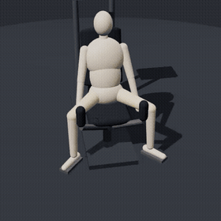](dist/animations/adductor.mp4) | [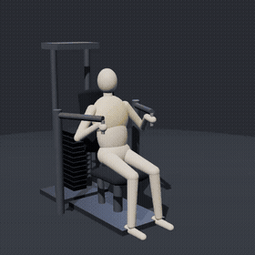](dist/animations/chest-press.mp4) | [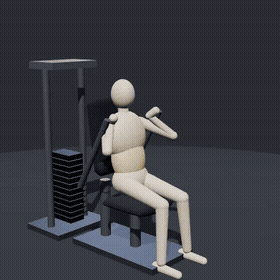](dist/animations/crunch-macchina.mp4) |

| Curl alla macchina | Hack squat | Iperestensioni | Leg curl sdraiato |
|:-:|:-:|:-:|:-:|
| [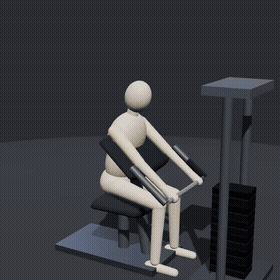](dist/animations/curl-macchina.mp4) | [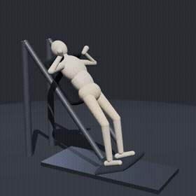](dist/animations/hack-squat.mp4) | [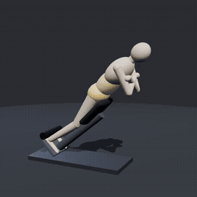](dist/animations/iperestensioni.mp4) | [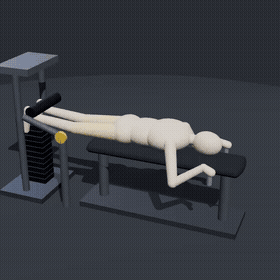](dist/animations/leg-curl-sdraiato.mp4) |

| Leg curl seduto | Leg extension | Polpacci alla leg press | Leg press |
|:-:|:-:|:-:|:-:|
| [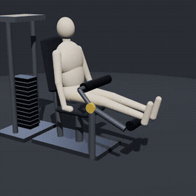](dist/animations/leg-curl-seduto.mp4) | [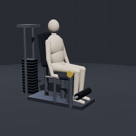](dist/animations/leg-extension.mp4) | [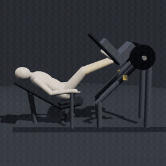](dist/animations/leg-press-polpacci.mp4) | [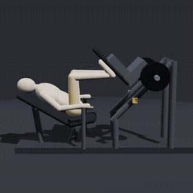](dist/animations/leg-press.mp4) |

| Pectoral machine | Polpacci in piedi | Polpacci da seduto | Reverse fly alla macchina |
|:-:|:-:|:-:|:-:|
| [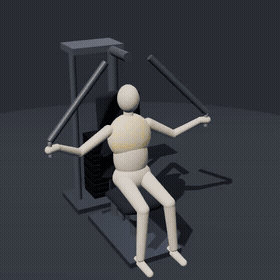](dist/animations/pectoral-machine.mp4) | [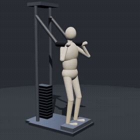](dist/animations/polpacci-in-piedi.mp4) | [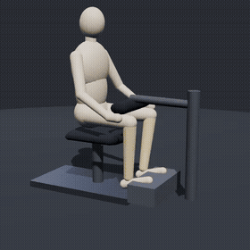](dist/animations/polpacci-seduto.mp4) | [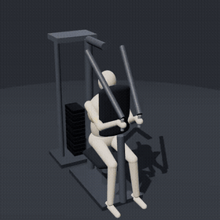](dist/animations/reverse-fly-macchina.mp4) |

| Rematore alla macchina | Shoulder press alla macchina | Squat al multipower | Tricipiti alla macchina |
|:-:|:-:|:-:|:-:|
| [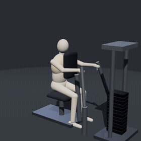](dist/animations/row-macchina.mp4) | [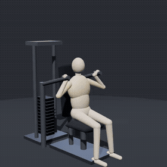](dist/animations/shoulder-press-macchina.mp4) | [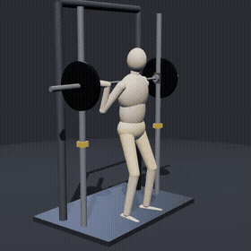](dist/animations/squat-multipower.mp4) | [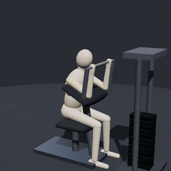](dist/animations/tricipiti-macchina.mp4) |

### Cavi

| Croci ai cavi | Face pull ai cavi | Lat machine | Pulley basso |
|:-:|:-:|:-:|:-:|
| [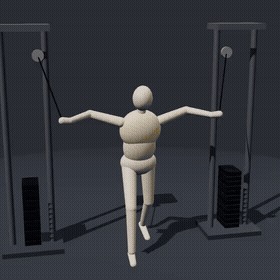](dist/animations/croci-cavi.mp4) | [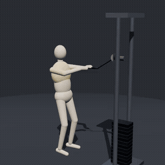](dist/animations/face-pull.mp4) | [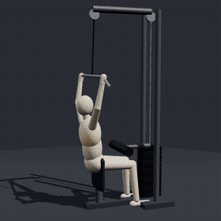](dist/animations/lat-machine.mp4) | [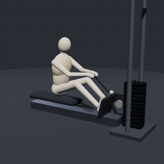](dist/animations/pulley.mp4) |

| Push down ai cavi |
|:-:|
| [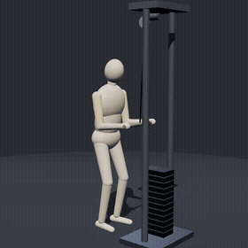](dist/animations/pushdown.mp4) |

### Pesi liberi

| Affondi con manubri | Alzate laterali con manubri | Curl con bilanciere | Curl con manubri |
|:-:|:-:|:-:|:-:|
| [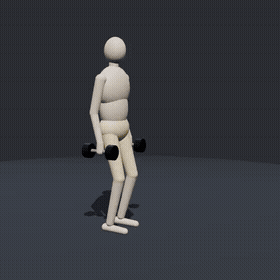](dist/animations/affondi.mp4) | [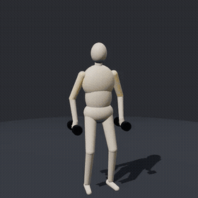](dist/animations/alzate-laterali.mp4) | [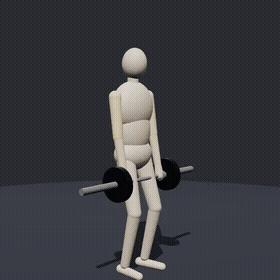](dist/animations/curl-bilanciere.mp4) | [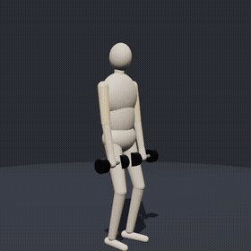](dist/animations/curl-manubri.mp4) |

| Goblet squat | Hip thrust e ponte per i glutei | Lento avanti con bilanciere in piedi | Lento con manubri da seduto |
|:-:|:-:|:-:|:-:|
| [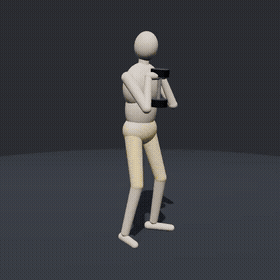](dist/animations/goblet-squat.mp4) | [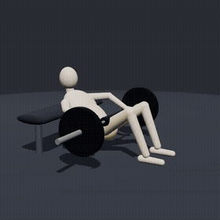](dist/animations/hip-thrust.mp4) | [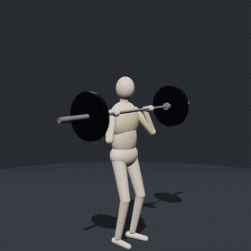](dist/animations/lento-avanti.mp4) | [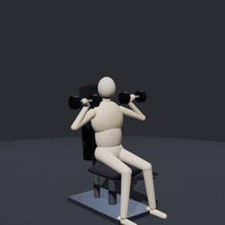](dist/animations/lento-manubri.mp4) |

| Panca inclinata con manubri | Panca piana con manubri | Panca piana con bilanciere | Rematore con bilanciere |
|:-:|:-:|:-:|:-:|
| [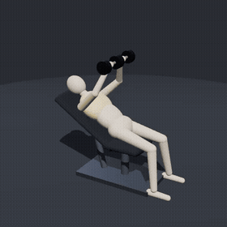](dist/animations/panca-inclinata-manubri.mp4) | [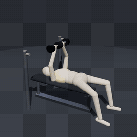](dist/animations/panca-manubri.mp4) | [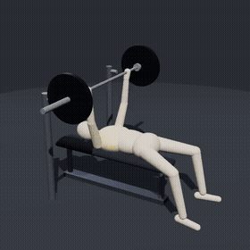](dist/animations/panca-piana.mp4) | [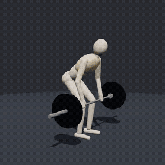](dist/animations/rematore-bilanciere.mp4) |

| Rematore con manubrio | Squat con bilanciere | Stacco rumeno | Stacco da terra |
|:-:|:-:|:-:|:-:|
| [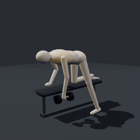](dist/animations/rematore-manubrio.mp4) | [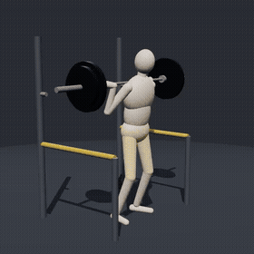](dist/animations/squat-bilanciere.mp4) | [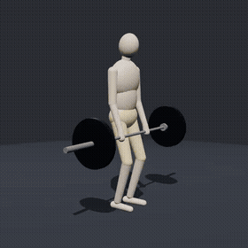](dist/animations/stacco-rumeno.mp4) | [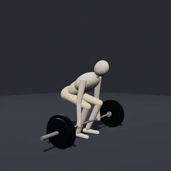](dist/animations/stacco.mp4) |

### Corpo libero

| Dip alle parallele | Piegamenti sulle braccia | Plank | Trazioni alla sbarra |
|:-:|:-:|:-:|:-:|
| [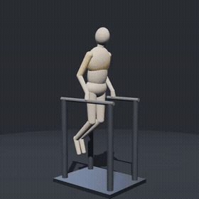](dist/animations/dip.mp4) | [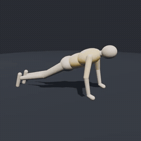](dist/animations/piegamenti.mp4) | [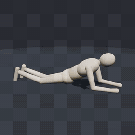](dist/animations/plank.mp4) | [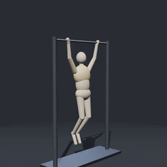](dist/animations/trazioni.mp4) |

I numeri gialli nei disegni (`<id>.setup.webp`) corrispondono ai passi di `setup` della scheda. Per ogni esercizio in
`dist/animations/` ci sono `<id>.webm` e `<id>.mp4` (circa 20–35 KB, per le app), `<id>.poster.webp`,
`<id>.setup.webp` e `<id>.gif` (per questa pagina). Come si rifanno: [animations/README.md](animations/README.md).

## Come si usa

Il file pronto è `dist/guides.it.json` (formato `ferro-guides-v1`). Si può leggere direttamente da jsDelivr,
gratis e senza chiavi:

```
https://cdn.jsdelivr.net/gh/JackMagna/ferro-esercizi@main/dist/guides.it.json
```

Per un'app conviene fissare un commit o un tag (`@v0.1.0`) al posto di `@main`, così i testi non cambiano
senza che tu lo sappia.

Ogni scheda indica in `libraryIds` gli esercizi di free-exercise-db che descrive: chi usa già quella libreria
(foto e muscoli) trova la scheda con lo stesso id.

## Com'è fatta

```
guides/it/<id>.json     una scheda per file (schema in schema/guide.schema.json)
guides/it/_safety.json  avvertenze comuni per macchine, pesi liberi e per tutti
sources.json            fonti consultate, per chiave
dist/guides.it.json     tutte le schede in un file, creato da scripts/build.mjs
```

Campi di una scheda: `id`, `name`, `aliases` (altri nomi usati dai coach), `libraryIds`, `kind`
(`macchina`, `cavi`, `pesi liberi`, `corpo libero`), `muscles`, `setup`, `steps`, `mistakes` (`error`, `fix`),
`cue` (la frase da ricordare durante la serie), `feel`, `stop`, `sources`, `reviewedBy`.

```bash
node scripts/build.mjs            # controlla le schede e rifà dist/
node scripts/build.mjs --check    # solo controllo (lo fa GitHub a ogni modifica)
```

Per le schede serve solo Node 20 o più recente, nessuna dipendenza. Le animazioni usano anche three.js (`npm install`), Playwright e ffmpeg.

## Da dove vengono i testi

I testi sono originali. Sono scritti confrontando le istruzioni pubbliche dei produttori
(manuali e cartelli di Life Fitness, Matrix, Precor, articoli di Technogym) e di associazioni
(ACE, NSCA, NASM, ACSM), elencate in `sources.json` e citate in ogni scheda.
Nessun testo, immagine o video è stato copiato. I nomi dei produttori servono solo a citare le fonti.

`reviewedBy` dice chi ha controllato la scheda (un coach o un fisioterapista). Le schede con `null`
non sono ancora state controllate da un professionista.

**Non sono consigli medici.** Sono indicazioni generali e non sostituiscono un istruttore o un medico.

## Licenza

- Testi, dati, video e disegni (`guides/`, `sources.json`, `dist/`): [CC BY-SA 4.0](LICENSE). Puoi copiarli, tradurli e usarli
  anche in progetti commerciali, citando **«ferro-esercizi»** con un link a questo repository.
  Se modifichi o traduci i testi, devi pubblicare la tua versione con la stessa licenza.
  Mostrarli in un'app non obbliga a cambiare la licenza dell'app.
- Script, schema e codice delle animazioni (`scripts/`, `schema/`, `animations/`): [MIT](LICENSE-CODE).

## Contribuire

Correzioni, nuove schede e traduzioni sono benvenute: vedi [CONTRIBUTING.md](CONTRIBUTING.md).
